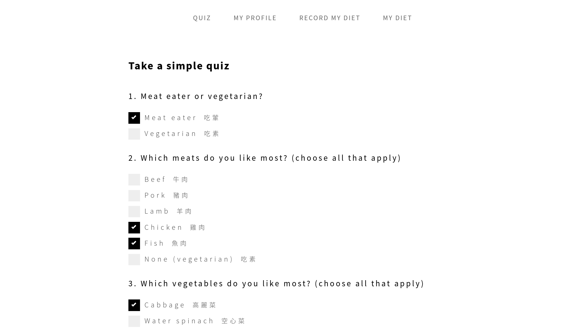
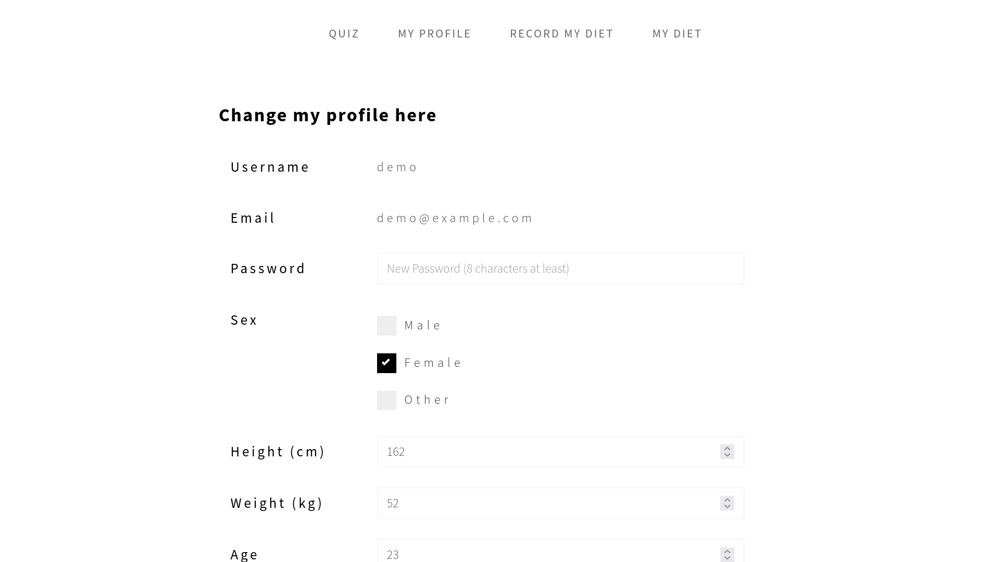
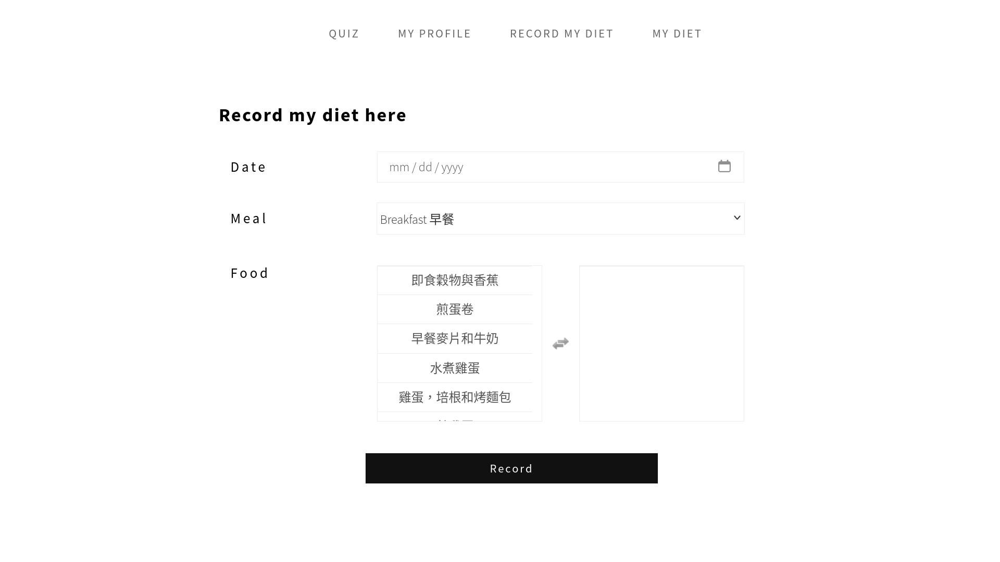
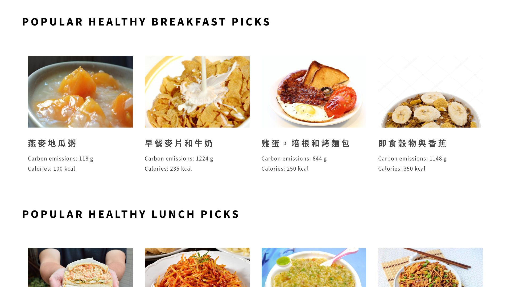
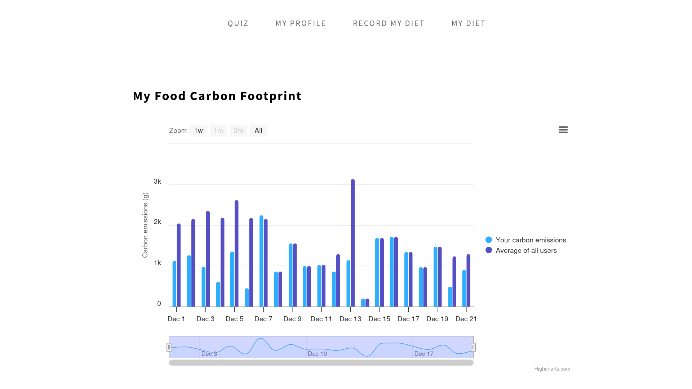
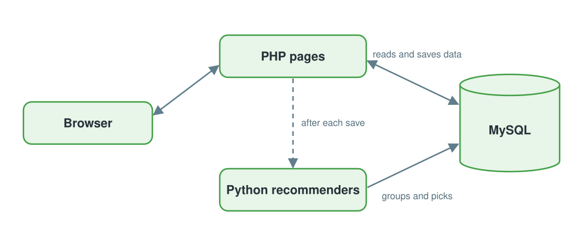
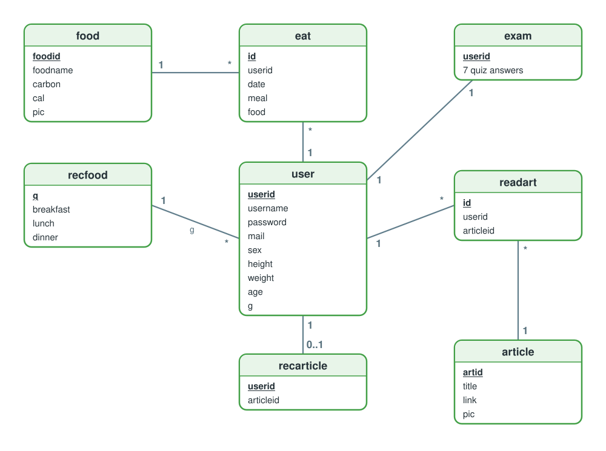

# Health Me

A recommender system for low-carbon, healthy eating: collaborative filtering picks foods from what people with similar habits eat, and content-based filtering picks health articles for each user's interests.

🔗 **Live demo:** https://healthme-app.onrender.com

🔑 **Demo account:** `demo` / `healthme-demo`

🎓 **Background:** Team capstone project in Information Management, advised by Prof. Duen-Ren Liu, National Yang Ming Chiao Tung University, 2018


---

## Features

- **Quiz** — answer 7 questions on how you eat and cook to personalize your food and article picks

  

- **My Profile** — update your sex, age, height and weight, which shape your food recommendations

  

- **Record My Diet** — log each meal from 228 foods with known calories and carbon emissions

  

- **Better Choice** — get low-carbon, low-calorie foods popular among people who eat like you

  

- **Articles** — get health articles matched to your quiz answers and reading history

  

- **My Diet** — compare your daily calories and carbon emissions with the average of all users

  

---

## How It Works

### Architecture



- **Collaborative filtering for food** — k-means clusters users on their meals, quiz answers and personal data, encoded as TF-IDF word vectors plus min-max scaled numbers, with k chosen by silhouette score; foods are then scored by popularity within the cluster, carbon and calories
- **Content-based filtering for articles** — Chinese health articles, collected with a Selenium and BeautifulSoup crawler, are split into words by jieba; TF-IDF cosine similarity then matches each user's quiz answers and reading history to the unread ones
- **Asynchronous recommendations** — the recommenders run in the background after each save, one at a time and at low priority, so pages never wait for them

### Data Model



Meals in `eat`, quiz answers in `exam`, personal data in `user` and reading history in `readart` feed the recommenders, which save their results in `recfood` and `recarticle`.

### Tech Stack

| Layer | Tools |
|---|---|
| Backend | PHP 8.2, PDO, Apache |
| Recommenders | Python 3.12, scikit-learn, NumPy, jieba, PyMySQL |
| Database | MySQL 8.4 on Aiven |
| Frontend | Bootstrap 3, jQuery, Highcharts Stock |
| Hosting | Render, Docker |

---

## Security

The live demo is public, so the code covers the main OWASP Top 10 risks:

- **SQL injection** — every query that takes user input is a prepared statement
- **Cross-site scripting** — everything users type is escaped before it appears on a page
- **Cross-site request forgery** — every form carries a secret token that the server checks
- **Stolen passwords** — passwords are stored only as bcrypt hashes
- **Session hijacking** — scripts can't read the session cookie, other sites can't post with it, it travels only over HTTPS, and the session ID changes at login
- **Security misconfiguration** — only `public/` is served, error details go only to the server log, and the database connection is encrypted with a verified certificate

---

## Running Locally

Requires Docker.

```bash
git clone https://github.com/cassielo/healthme-app.git
cd healthme-app
docker compose up --build
```

Then open http://localhost:8001 and log in with `demo` / `healthme-demo`. The database is created from `healthme.sql` on the first start.

---

## Project Structure

```
public/              web root: pages, form handlers, assets
includes/            database connection and helpers, session, CSRF, login check
recommender/         foodrec.py, blogrec.py, blogcrawler.py, articles, jieba dictionary, requirements.txt
Dockerfile           web server image: Apache, PHP and the Python recommenders
docker/              PHP error settings
healthme.sql         database schema and data
docker-compose.yml   local setup: web, MySQL, Adminer
render.yaml          Render deployment config
docs/                README screenshots and diagrams
```
